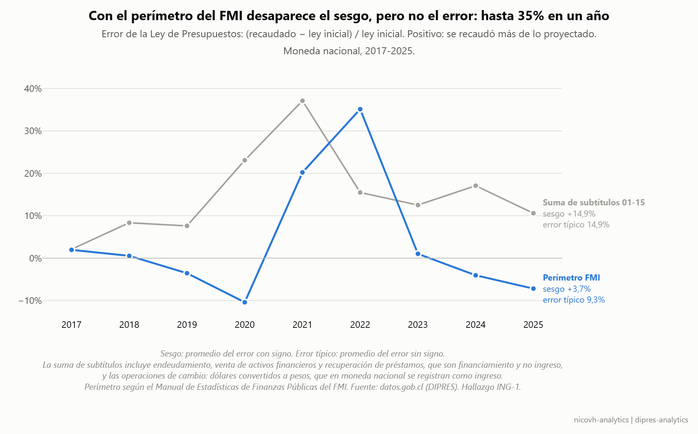

# DIPRES — Auditoría de datos presupuestarios

[](https://github.com/Nicovh-Analytics/dipres-analytics/actions/workflows/tests.yml)

**¿Los datos de ejecución presupuestaria que DIPRES publica en datos.gob.cl alcanzan para fiscalizar el gasto del Gobierno Central?** Para el agregado, sí: el dataset cuadra con el texto de cada Ley de Presupuestos y con Contraloría, y concilia con la cifra oficial de ingresos. Para el programa, no del todo: el archivo de ley por programa publica totales que su propio detalle no suma, y el gasto de los programas sociales solo se puede trazar a su línea presupuestaria en 2018.

> *English summary: an audit of the budget execution data that Chile's Budget Office (DIPRES) publishes as open data (2017–2026). Instead of describing spending, it tests whether the published data is enough to audit it — against itself (consistency across levels), against the law (each Budget Act, extracted from the official text), against an independent third party (the Comptroller General's annual report) and against what social programs report. The aggregate is auditable: the dataset matches the law in 5,929 of 5,931 ministry × budget-line combinations and reconciles with the official revenue figure within 0.55%. The program level is not: published program totals don't add up to their own detail, and social programs can only be traced to budget lines for 2018.*

> En desarrollo · hallazgos preliminares; consultas por Ley de Transparencia pendientes de respuesta.



## Qué se contrasta

| Referencia | Fuente |
|---|---|
| Consigo mismo | consistencia entre niveles (nacional, partida, capítulo, programa) y entre meses |
| La norma | artículo 1 y cuadros por partida de cada Ley de Presupuestos ([LeyChile](https://www.bcn.cl/leychile)) |
| Un tercero | Informe de la Gestión Financiera del Estado (Contraloría) |
| Los programas | bases de monitoreo de programas sociales (SES-DIPRES, MDSF) |

No busca describir en qué gasta el Estado —eso ya lo hace el Observatorio del Gasto Fiscal—, sino evaluar la calidad y el alcance del dato publicado. Qué estaba reportado y qué es nuevo: [`docs/ANTECEDENTES.md`](docs/ANTECEDENTES.md).

## Hallazgos

**Con datos públicos se audita el agregado, no el programa.**

| Nivel | ¿Auditable desde afuera? | Hallazgos |
|---|---|---|
| Presupuesto nacional y por partida | Sí | CAL-1, VAL-1, ING-5 |
| Ejecución por partida | Con reservas: DIPRES y Contraloría difieren en las mismas líneas | VAL-2 |
| Límites legales (arts. 3 y 4) | Solo por estimación | DEU-1, MOD-2 |
| Programa presupuestario | No del todo: totales que su detalle no suma | CAL-4 |
| Programa social → línea presupuestaria | Solo para 2018 | MON-1, MON-2 |

Los principales:

- **ING-1 · El sesgo de proyección de ingresos es un efecto de perímetro.** Sumando los subtítulos 01–15, la ley subestima lo recaudado los 9 años (+14,9%, p = 0,004). Al excluir lo que es financiamiento y no ingreso, el sesgo deja de ser significativo (+3,7%).
- **ING-5 · Los datos abiertos concilian con la cifra oficial, pero la conciliación no se publica.** Con el perímetro del manual del FMI, los ingresos 2024 difieren en −0,55% del Informe de Finanzas Públicas; sumados sin conocer la reclasificación, el resultado es técnicamente correcto y analíticamente falso.
- **VAL-2 · La ejecución difiere de la de Contraloría en las mismas partidas cada año.** El presupuesto por partida cuadra en 305 de 310 casos; el devengado no siempre, casi siempre con el dataset por debajo, y ninguno de los dos informes lo explica.
- **CAL-4 · La ley por programa publica totales que su detalle no suma.** En 2024 y 2025, 632 subtítulos con líneas que faltan o sobran; la versión publicada sigue igual.
- **MON-1 · Un tercio de las líneas que declaran los programas sociales no calza con la ejecución** (166 de 477 en 2018, la única base que publica la línea presupuestaria).

Los 25 hallazgos, con condición, criterio, evidencia y alcance, están en [`docs/HALLAZGOS.md`](docs/HALLAZGOS.md), que se regenera desde el pipeline. Los problemas de la fuente, en [`docs/CALIDAD_FUENTE.md`](docs/CALIDAD_FUENTE.md).

## Estructura

```
dipres/        módulos compartidos (paquete importable)
pipeline/      scripts del pipeline, una carpeta por etapa
exploratorio/  catálogo inicial de la API CKAN
archivo/       scripts reemplazados o de una sola vez
herramientas/  mapa de dependencias y manifiesto de datos (fuera del pipeline)
docs/          hallazgos, calidad de la fuente y lecciones aprendidas
run.py         corre el pipeline por etapas
```

Los datos viven fuera del repo. La ruta se define con la variable de
entorno `DIPRES_HOME` (por defecto `D:\data\dipres-datos`):

```
raw/          descargado; las versiones reemplazadas quedan en _versiones/
processed/    consolidados y cruces generados por el pipeline
reports/      salidas de validación y análisis
logs/         metadata de descarga
```

## Módulos compartidos (`dipres/`)

| Módulo | Responsabilidad |
|---|---|
| `config.py` | rutas, endpoints, tolerancias, años de corte |
| `dominio.py` | clasificador presupuestario, concordancia GFS, tipos de cambio, autorizaciones de endeudamiento |
| `normativa.py` | corpus legal y régimen por subtítulo |
| `estructura.py` | altas, bajas, traslados y renombres de instituciones |
| `descarga.py` | descarga con verificación por SHA-256 y respaldo de versiones |
| `utils.py` | lectura robusta de CSV |
| `hallazgos.py` | registro de controles (✓ / ⚠ / ❌) de cada script |
| `viz.py` | estilo y paleta de los gráficos |

Cada hecho vive en un solo lugar. Si un subtítulo se reclasifica, se
corrige en `dominio.py` y todo el pipeline queda consistente.

## Pipeline

| Etapa | Scripts |
|---|---|
| 1. Extracción | `02` ejecución y ley · `03` iniciativas de inversión · `03b` bases de monitoreo de programas sociales (MDSF) · `04` tipos de cambio (Banco Central) · `12` corpus legal (LeyChile, Dipres) · `13` tablas del artículo 1 |
| 2. Consolidación | `05` crudos → consolidados y cruce ley/ejecución · `07` diccionario de datos |
| 3. Validación | `04` perfil · `06` consistencia interna · `14` dataset vs artículo 1 · `15` dataset vs tablas por partida · `15b` dataset vs Contraloría |
| 4. Análisis | `10` conciliación GFS · `11b` tope de endeudamiento · `11c` bonos de los reportes de deuda · `16` modificaciones · `17` ejecución · `18` ingresos · `18b` fuentes de financiamiento · `18c` bonos vs subtítulo 14 · `18d` margen de endeudamiento · `19` aporte fiscal · `20` estructura institucional · `24` monitoreo de programas vs ejecución |
| 5. Informe | `21` genera [`docs/HALLAZGOS.md`](docs/HALLAZGOS.md) · `22` y `23` gráficos |

Cada script deja sus controles en `reports/_controles/`; `run.py` los resume
en una tabla al final y se detiene si alguno queda en ❌. El mapa de
dependencias entre scripts está en [`docs/flujo.md`](docs/flujo.md).

## Problemas de datos resueltos

| Problema | Causa | Solución |
|---|---|---|
| Columnas corridas | `;` sobrante al final de fila | se descarta el campo vacío |
| Delimitador dentro de texto | `;` en nombres de asignación | reparación por conteo de campos |
| Producto cartesiano (17,7M → 1,4M filas) | faltaban `Item` y `Asignación` en las claves | claves completas por nivel |
| Ejecución descartada sin aviso | cruce left join desde la ley | outer join con columna `origen` |
| Línea de ley al doble exacto | error de la fuente | se descarta la copia y se registra |
| Encoding mixto | archivos en cp1252 | se decodifica el archivo completo: utf-8 → cp1252 → latin-1 |

Detalle en [`docs/CALIDAD_FUENTE.md`](docs/CALIDAD_FUENTE.md) y
[`docs/lecciones_datos_dipres.md`](docs/lecciones_datos_dipres.md).

## Reproducir

```bash
git clone https://github.com/Nicovh-Analytics/dipres-analytics.git && cd dipres-analytics
pip install -e .
export DIPRES_HOME=/d/data/dipres-datos     # Git Bash; ajustar
python run.py --lista                  # etapas y scripts
python run.py --todo                   # descarga → informe
python run.py                          # desde consolidación (sin red)
python run.py --solo analisis
python herramientas/manifiesto.py --verificar   # ¿mis datos son los mismos del análisis?
```

[`docs/manifiesto_datos.csv`](docs/manifiesto_datos.csv) registra el SHA-256
de cada archivo de entrada con el que se obtuvieron los resultados.

## Marco normativo

- **DL 1.263/1975** — Administración Financiera del Estado
- **DS 854/2004** — Clasificador presupuestario
- **Ley 20.285** — Transparencia; exige que la información pública sea veraz
- **Ley de Presupuestos anual** — artículos 1 (cálculo de ingresos y gastos), 3 (endeudamiento), 4 (topes), 32 (gastos excedibles)
- **Ley 21.225** — endeudamiento adicional de hasta US$ 4.000 millones en 2020
- **Ley 21.288** — Fondo COVID; endeudamiento adicional 2020–2022
- **MEFP 2001/2014 (FMI)** — marco del Estado de Operaciones de Gobierno

## Estado

- [x] Extracción, consolidación y validación interna
- [x] Validación contra el artículo 1 y las tablas por partida de la ley
- [x] Conciliación de ingresos con la cifra oficial (2024: −0,55%)
- [x] Topes del artículo 4 y límite de endeudamiento del artículo 3
- [x] Modificaciones, ejecución y estructura institucional
- [x] Síntesis de hallazgos en formato de auditoría
- [ ] Cruce a nivel programa por subtítulo e ítem
- [x] Cruce con el monitoreo de programas sociales (2018 por línea; 2022-2024 por capítulo)
- [x] Visualización (gráficos de los hallazgos en [`docs/graficos/`](docs/graficos/))
- [x] Reproducibilidad: controles por script, manifiesto de datos, años de corte en un solo lugar
- [x] Validación externa contra el IGFE de Contraloría (presupuesto y ejecución por partida)
- [ ] Respuesta a consultas por Ley 20.285: DIPRES y CGR (ejecución, 16-10), DIPRES (art. 3, 03-11; ley por programa, 06-11) y Subsecretaría de Evaluación Social (monitoreo, por enviar)

## Sobre el uso de IA

Este proyecto se desarrolló con Claude (Anthropic) como asistente de programación y análisis. Gran parte del código surgió de esa colaboración: yo definí las preguntas, el criterio de auditoría (qué contrastar, con qué fuente externa y con qué umbral de materialidad) y la interpretación de los resultados; revisé y ejecuté cada script y validé sus salidas contra las fuentes. Varias hipótesis, mías y de la IA, se descartaron al contrastarlas con los datos; quedan documentadas en [CALIDAD_FUENTE.md](docs/CALIDAD_FUENTE.md). Las consultas por Ley de Transparencia y la responsabilidad por lo publicado son mías.