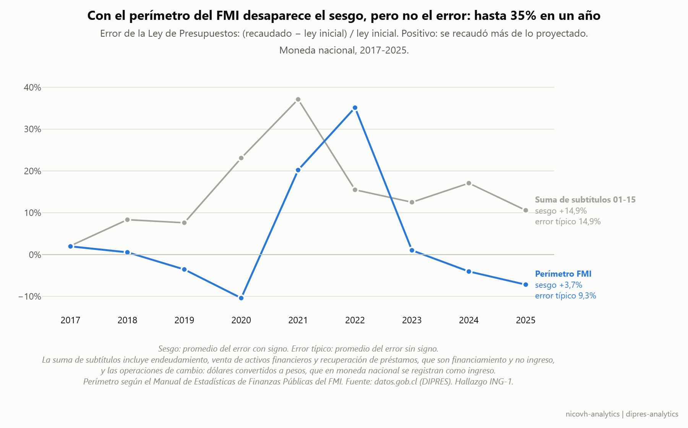
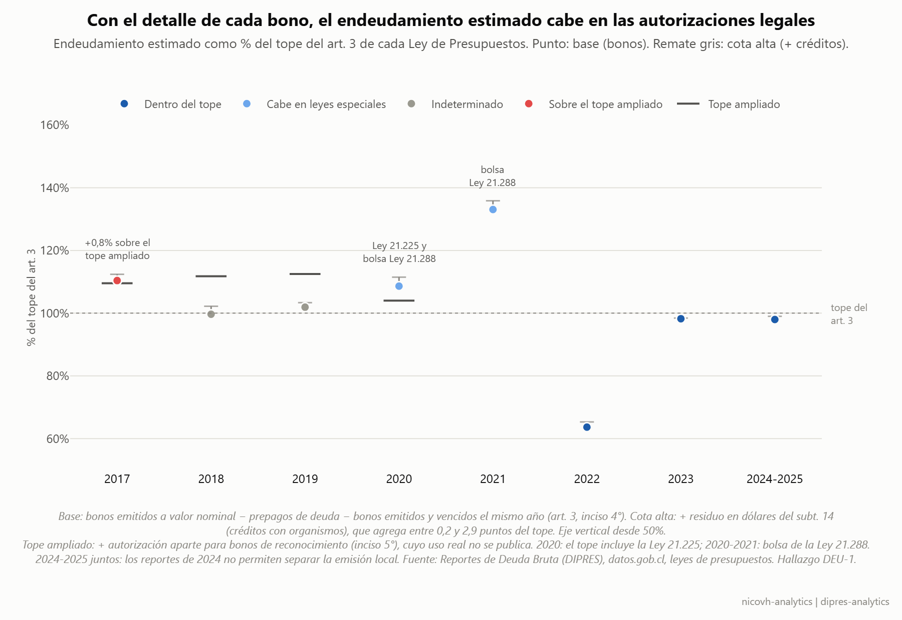
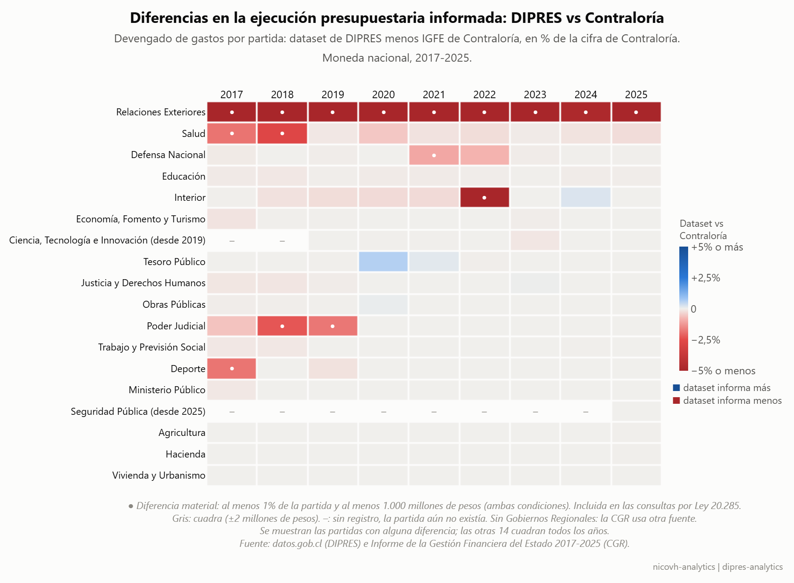

# DIPRES — Auditoría de datos presupuestarios

> En desarrollo · hallazgos preliminares, metodología en revisión.

Este proyecto examina si los datos de ejecución presupuestaria que DIPRES
publica en [datos.gob.cl](https://datos.gob.cl) permiten fiscalizar el gasto
del Gobierno Central (2017–2026), y si la ejecución se ajusta a lo que la ley
autoriza. No busca describir en qué gasta el Estado —eso ya lo hace el
Observatorio del Gasto Fiscal—, sino evaluar la calidad y el alcance del dato
publicado.

Para eso, los datos se contrastan con tres referencias:

1. **Consigo mismos**: consistencia entre niveles (nacional, partida, capítulo, programa) y entre meses.
2. **Con la norma**: el texto de cada Ley de Presupuestos (artículo 1 y cuadros por partida), desde [LeyChile](https://www.bcn.cl/leychile).
3. **Con un tercero**: el Informe de la Gestión Financiera del Estado de la Contraloría.

**Dónde mirar:** los hallazgos con su evidencia están en
[`docs/HALLAZGOS.md`](docs/HALLAZGOS.md), los problemas de la fuente en
[`docs/CALIDAD_FUENTE.md`](docs/CALIDAD_FUENTE.md), y cómo reproducir todo en
[Reproducir](#reproducir).

## Hallazgos

Resumen de los hallazgos. El detalle de cada uno (condición, criterio,
evidencia y alcance) está en [`docs/HALLAZGOS.md`](docs/HALLAZGOS.md), que
se regenera desde los reportes del pipeline.

**Ingresos: el sesgo de proyección es un efecto de perímetro.**
Si se suman los subtítulos 01–15, la ley subestima lo recaudado los 9 años
(+14,9%, p = 0,004). Al excluir lo que es financiamiento y no ingreso
(endeudamiento, venta de activos financieros, recuperación de préstamos),
el sesgo deja de ser significativo (+3,7%, p = 1,0): el 76% del error viene
de líneas que en la ley son autorizaciones, no estimaciones. Impuestos no
tiene sesgo acumulado (+0,1%), pero en 7 de 9 años recauda menos de lo
proyectado (mediana −6,1%).



**Los datos abiertos concilian con la cifra oficial, pero la conciliación no se publica.**
Con el perímetro del manual del FMI, los ingresos 2024 del dataset difieren
en −0,55% de la cifra del Informe de Finanzas Públicas. DIPRES documenta la
reclasificación en sus anexos metodológicos, pero no la incluye en el
dataset: si se suman los datos abiertos sin conocerla, el resultado es
técnicamente correcto y analíticamente falso.

**El presupuesto de gastos se amplía todos los años.**
La ley vigente al cierre supera a la inicial en los 9 años (mediana +17,5%;
+61,4% en 2021). En pesos, los aumentos de gasto corriente caben en las
excepciones del artículo 4. En dólares, 5 años muestran aumentos sin
excepción medible (hasta US$ 87 millones), que requieren un respaldo legal
que el dataset no muestra.

**La ejecución repite patrones.**
Se ejecuta entre el 93,7% y el 99,0% de lo autorizado, pero las mismas
líneas subejecutan año tras año (inversión de Educación: 9 de 9 años,
mediana 62%) y las compras de activos se concentran en diciembre (Poder
Judicial: mediana 78% del gasto del año en ese mes).

**Endeudamiento: con el detalle de cada bono, cabe en las autorizaciones legales.**
Con los Reportes de Deuda Bruta de DIPRES, bono por bono, el endeudamiento de
2022 a 2025 queda dentro del tope del artículo 3. En 2020 y 2021 lo supera,
pero cabe en la Ley 21.225 y en la bolsa del Fondo COVID (Ley 21.288: exceso
de US$ 7.521 millones sobre una bolsa de 8.000). 2018 y 2019 quedan en el
límite (100% y 102% del tope): no se publica cuánto se usó de la autorización
aparte para bonos de reconocimiento. 2017 supera el tope ampliado en 0,8%,
menos que el margen de error de la estimación.



**La estructura del Estado se puede leer en la ley.**
Entre 2018 y 2026 hubo 85 altas, 30 bajas y 6 traslados de servicios; los
capítulos pasaron de 208 a 268. El traspaso de la educación municipal se ve
completo: 59 Servicios Locales de Educación. Entre 2018 y 2020, el 79% de los
cambios ocurrió a mitad de año; entre 2022 y 2026, solo el 9%.

**El presupuesto publicado coincide con el de Contraloría; la ejecución no siempre.**
Contrastado con el Informe de la Gestión Financiera del Estado (CGR, 2017-2025),
el presupuesto por partida cuadra en 305 de 310 casos. El devengado difiere en
líneas puntuales, casi siempre con el dataset por debajo y en las mismas partidas
cada año (RREE todos los años). Los informes no explican la diferencia; se
enviaron consultas por Ley 20.285 a DIPRES y a la CGR.



**Calidad de la fuente.**
En 59 casos una partida suma más que sus capítulos, algo que no puede
deberse a la consolidación. El 86% coincide con un servicio creado a mitad
de año, y no hay casos desde 2021. Hay líneas de ley repetidas con el monto
exacto al doble (Primera Categoría, enero 2020: 8,3 billones de pesos
repetidos como 16,5). El artículo 1 de la ley, el detalle que aprueba el
Congreso, se publica en LeyChile como imagen. Extraído, cuadra con el
dataset en 5.927 de 5.929 combinaciones partida × subtítulo. En 2024 y 2025,
el archivo de ley por programa publica totales que su propio detalle no suma
(862 subtítulos; en agosto de 2024 faltan 110,5 billones de pesos en el
detalle de impuestos del Tesoro), y la versión publicada sigue igual. Detalle
en [`docs/CALIDAD_FUENTE.md`](docs/CALIDAD_FUENTE.md).

## Estructura

```
dipres/        módulos compartidos (paquete importable)
pipeline/      scripts del pipeline, una carpeta por etapa
exploratorio/  catálogo inicial de la API CKAN
archivo/       scripts reemplazados o de una sola vez
herramientas/  mapa de dependencias y manifiesto de datos (fuera del pipeline)
docs/          hallazgos, calidad de la fuente y lecciones aprendidas
run.py         corre el pipeline por etapas
```

Los datos viven fuera del repo. La ruta se define con la variable de
entorno `DIPRES_HOME` (por defecto `D:\data\dipres-datos`):

```
raw/          descargado; las versiones reemplazadas quedan en _versiones/
processed/    consolidados y cruces generados por el pipeline
reports/      salidas de validación y análisis
logs/         metadata de descarga
```

## Módulos compartidos (`dipres/`)

| Módulo | Responsabilidad |
|---|---|
| `config.py` | rutas, endpoints, tolerancias, años de corte |
| `dominio.py` | clasificador presupuestario, concordancia GFS, tipos de cambio, autorizaciones de endeudamiento |
| `normativa.py` | corpus legal y régimen por subtítulo |
| `estructura.py` | altas, bajas, traslados y renombres de instituciones |
| `descarga.py` | descarga con verificación por SHA-256 y respaldo de versiones |
| `utils.py` | lectura robusta de CSV |
| `hallazgos.py` | registro de controles (✓ / ⚠ / ❌) de cada script |
| `viz.py` | estilo y paleta de los gráficos |

Cada hecho vive en un solo lugar. Si un subtítulo se reclasifica, se
corrige en `dominio.py` y todo el pipeline queda consistente.

## Pipeline

| Etapa | Scripts |
|---|---|
| 1. Extracción | `02` ejecución y ley · `03` iniciativas de inversión · `04` tipos de cambio (Banco Central) · `12` corpus legal (LeyChile, Dipres) · `13` tablas del artículo 1 |
| 2. Consolidación | `05` crudos → consolidados y cruce ley/ejecución · `07` diccionario de datos |
| 3. Validación | `04` perfil · `06` consistencia interna · `14` dataset vs artículo 1 · `15` dataset vs tablas por partida · `15b` dataset vs Contraloría |
| 4. Análisis | `10` conciliación GFS · `11b` tope de endeudamiento · `11c` bonos de los reportes de deuda · `16` modificaciones · `17` ejecución · `18` ingresos · `18b` fuentes de financiamiento · `18c` bonos vs subtítulo 14 · `18d` margen de endeudamiento · `19` aporte fiscal · `20` estructura institucional |
| 5. Informe | `21` genera [`docs/HALLAZGOS.md`](docs/HALLAZGOS.md) · `22` y `23` gráficos |

Cada script deja sus controles en `reports/_controles/`; `run.py` los resume
en una tabla al final y se detiene si alguno queda en ❌. El mapa de
dependencias entre scripts está en [`docs/flujo.md`](docs/flujo.md).

## Problemas de datos resueltos

| Problema | Causa | Solución |
|---|---|---|
| Columnas corridas | `;` sobrante al final de fila | se descarta el campo vacío |
| Delimitador dentro de texto | `;` en nombres de asignación | reparación por conteo de campos |
| Producto cartesiano (17,7M → 1,4M filas) | faltaban `Item` y `Asignación` en las claves | claves completas por nivel |
| Ejecución descartada sin aviso | cruce left join desde la ley | outer join con columna `origen` |
| Línea de ley al doble exacto | error de la fuente | se descarta la copia y se registra |
| Encoding mixto | archivos en cp1252 | se decodifica el archivo completo: utf-8 → cp1252 → latin-1 |

Detalle en [`docs/CALIDAD_FUENTE.md`](docs/CALIDAD_FUENTE.md) y
[`docs/lecciones_datos_dipres.md`](docs/lecciones_datos_dipres.md).

## Reproducir

```bash
git clone <url> && cd dipres-analytics
pip install -e .
export DIPRES_HOME=/d/data/dipres-datos     # Git Bash; ajustar
python run.py --lista                  # etapas y scripts
python run.py --todo                   # descarga → informe
python run.py                          # desde consolidación (sin red)
python run.py --solo analisis
python herramientas/manifiesto.py --verificar   # ¿mis datos son los mismos del análisis?
```

[`docs/manifiesto_datos.csv`](docs/manifiesto_datos.csv) registra el SHA-256
de cada archivo de entrada con el que se obtuvieron los resultados.

## Marco normativo

- **DL 1.263/1975** — Administración Financiera del Estado
- **DS 854/2004** — Clasificador presupuestario
- **Ley 20.285** — Transparencia; exige que la información pública sea veraz
- **Ley de Presupuestos anual** — artículos 1 (cálculo de ingresos y gastos), 3 (endeudamiento), 4 (topes), 32 (gastos excedibles)
- **Ley 21.225** — endeudamiento adicional de hasta US$ 4.000 millones en 2020
- **Ley 21.288** — Fondo COVID; endeudamiento adicional 2020–2022
- **MEFP 2001/2014 (FMI)** — marco del Estado de Operaciones de Gobierno

## Estado

- [x] Extracción, consolidación y validación interna
- [x] Validación contra el artículo 1 y las tablas por partida de la ley
- [x] Conciliación de ingresos con la cifra oficial (2024: −0,55%)
- [x] Topes del artículo 4 y límite de endeudamiento del artículo 3
- [x] Modificaciones, ejecución y estructura institucional
- [x] Síntesis de hallazgos en formato de auditoría
- [ ] Cruce a nivel programa por subtítulo e ítem
- [x] Visualización (gráficos de los hallazgos en [`docs/graficos/`](docs/graficos/))
- [x] Reproducibilidad: controles por script, manifiesto de datos, años de corte en un solo lugar
- [x] Validación externa contra el IGFE de Contraloría (presupuesto y ejecución por partida)
- [ ] Respuesta a consultas por Ley 20.285 (DIPRES y CGR, enviadas el 16-10-2026)

## Sobre el uso de IA

Este proyecto se desarrolló con Claude (Anthropic) como asistente de programación y análisis. Gran parte del código surgió de esa colaboración: yo definí las preguntas, el criterio de auditoría (qué contrastar, con qué fuente externa y con qué umbral de materialidad) y la interpretación de los resultados; revisé y ejecuté cada script y validé sus salidas contra las fuentes. Varias hipótesis, mías y de la IA, se descartaron al contrastarlas con los datos; quedan documentadas en [CALIDAD_FUENTE.md](docs/CALIDAD_FUENTE.md). Las consultas por Ley de Transparencia y la responsabilidad por lo publicado son mías.