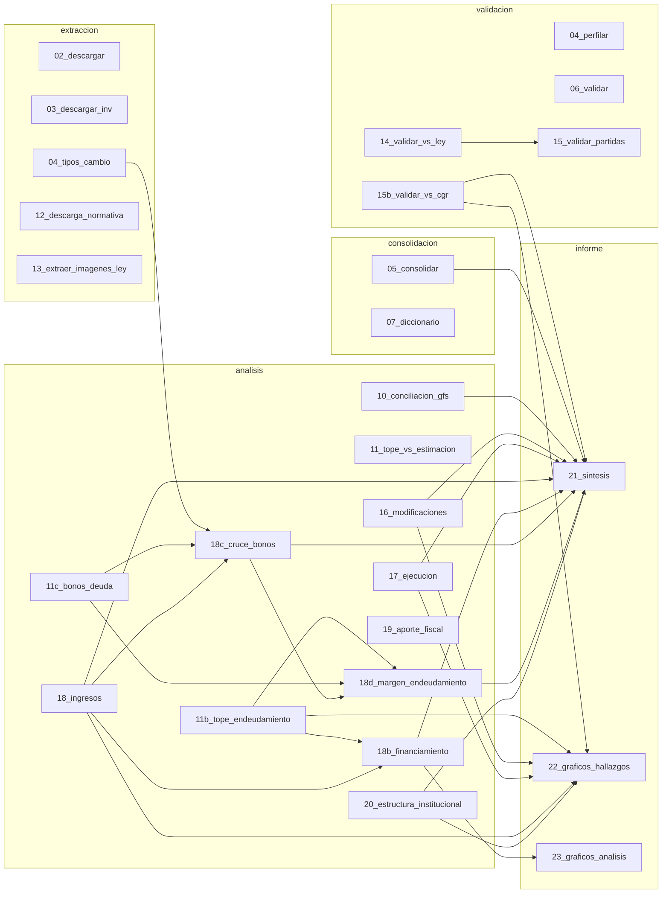

# Flujo de datos del pipeline

> Generado por `herramientas/mapa_flujo.py` desde el código. No editar a mano.

Flecha punteada: el script lee la salida de otro que corre después.

## Entradas externas

| Archivo | Lo usa |
|---|---|
| `IGFE*.pdf` | 15b_validar_vs_cgr |
| `art1_ley_presupuestos.csv` | 14_validar_vs_ley |
| `cruce_*.csv` | 14_validar_vs_ley, 16_modificaciones |
| `cruce_nacional.csv` | 10_conciliacion_gfs, 11_tope_vs_estimacion, 18_ingresos |
| `cruce_partida.csv` | 11b_tope_endeudamiento, 15_validar_partidas, 15b_validar_vs_cgr, 17_ejecucion |
| `cruce_programa.csv` | 11b_tope_endeudamiento |
| `ejecucion_programa_consolidado.parquet` | 18b_financiamiento |

## Archivos por script

| Script | Lee | Escribe |
|---|---|---|
| `1_extraccion/02_descargar.py` | — | — |
| `1_extraccion/03_descargar_inv.py` | — | — |
| `1_extraccion/04_tipos_cambio.py` | — | anual.csv, diario.csv |
| `1_extraccion/12_descarga_normativa.py` | — | — |
| `1_extraccion/13_extraer_imagenes_ley.py` | — | — |
| `2_consolidacion/05_consolidar.py` | — | _log_consolidar_*.json |
| `2_consolidacion/07_diccionario.py` | — | — |
| `3_validacion/04_perfilar.py` | — | — |
| `3_validacion/06_validar.py` | — | — |
| `3_validacion/14_validar_vs_ley.py` | art1_ley_presupuestos.csv, cruce_*.csv | art1_ley_presupuestos_dipres.csv |
| `3_validacion/15_validar_partidas.py` | art1_ley_presupuestos_dipres.csv, cruce_partida.csv | partidas_ley_dipres.csv |
| `3_validacion/15b_validar_vs_cgr.py` | IGFE*.pdf, cruce_partida.csv | cgr_partidas.csv, cgr_revisiones.csv, validacion_cgr.csv, validacion_cgr_subtitulo.csv |
| `4_analisis/10_conciliacion_gfs.py` | cruce_nacional.csv | conciliacion_ingresos.csv, tipo_cambio_desvio.csv |
| `4_analisis/11_tope_vs_estimacion.py` | cruce_nacional.csv | tope_vs_estimacion.csv |
| `4_analisis/11b_tope_endeudamiento.py` | cruce_partida.csv, cruce_programa.csv | tope_endeudamiento.csv |
| `4_analisis/11c_bonos_deuda.py` | — | deuda_bonos.csv, deuda_emisiones.csv, deuda_prepagos.csv |
| `4_analisis/16_modificaciones.py` | cruce_*.csv | modificaciones_*.csv |
| `4_analisis/17_ejecucion.py` | cruce_partida.csv | ejecucion_*.csv |
| `4_analisis/18_ingresos.py` | cruce_nacional.csv | ingresos_*.csv |
| `4_analisis/18b_financiamiento.py` | ejecucion_programa_consolidado.parquet, ingresos_detalle.csv, tope_endeudamiento.csv | financiamiento_activos.csv, financiamiento_fuentes.csv |
| `4_analisis/18c_cruce_bonos.py` | deuda_emisiones.csv, diario.csv, ingresos_detalle.csv | deuda_cruce_subt14.csv, deuda_emisiones_usd.csv |
| `4_analisis/18d_margen_endeudamiento.py` | deuda_cruce_subt14.csv, deuda_emisiones_usd.csv, deuda_prepagos.csv, tope_endeudamiento.csv | margen_endeudamiento.csv |
| `4_analisis/19_aporte_fiscal.py` | — | aporte_fiscal_brechas.csv, aporte_fiscal_por_ministerio.csv |
| `4_analisis/20_estructura_institucional.py` | — | descuadres_partida_capitulo.csv, estructura_eventos.csv, estructura_resumen_anual.csv |
| `5_informe/21_sintesis.py` | _log_consolidar_*.json, cgr_revisiones.csv, conciliacion_ingresos.csv, descuadres_partida_capitulo.csv, deuda_cruce_subt14.csv, ejecucion_recurrencia.csv, ejecucion_resumen.csv, estructura_eventos.csv, estructura_resumen_anual.csv, financiamiento_activos.csv, financiamiento_fuentes.csv, ingresos_agregados.csv, ingresos_contribucion.csv, ingresos_detalle.csv, ingresos_prueba_signo.csv, margen_endeudamiento.csv, modificaciones_art4.csv, modificaciones_resumen.csv, tipo_cambio_desvio.csv, validacion_cgr.csv, validacion_cgr_subtitulo.csv | HALLAZGOS.md |
| `5_informe/22_graficos_hallazgos.py` | ejecucion_recurrencia.csv, ejecucion_resumen.csv, estructura_resumen_anual.csv, ingresos_agregados.csv, modificaciones_resumen.csv, tope_endeudamiento.csv, validacion_cgr.csv | — |
| `5_informe/23_graficos_analisis.py` | financiamiento_fuentes.csv | — |
